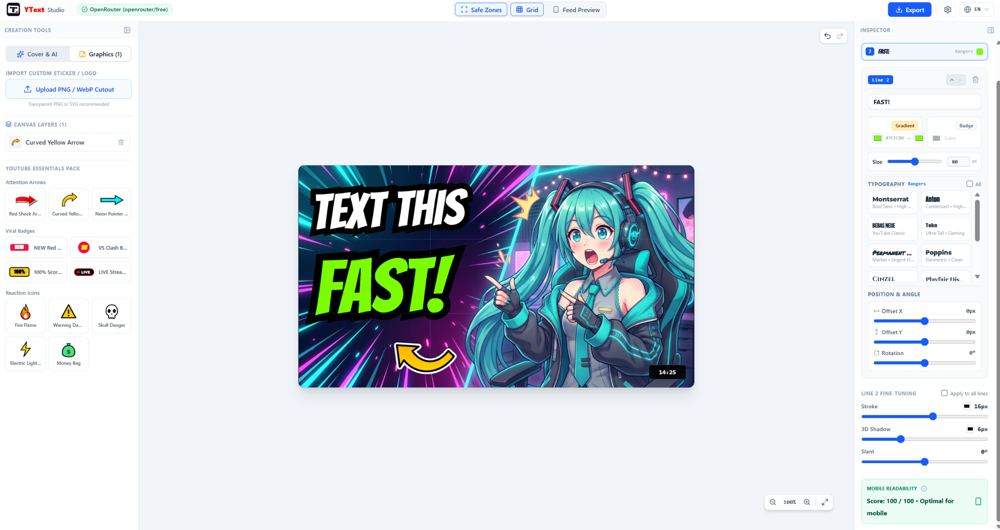
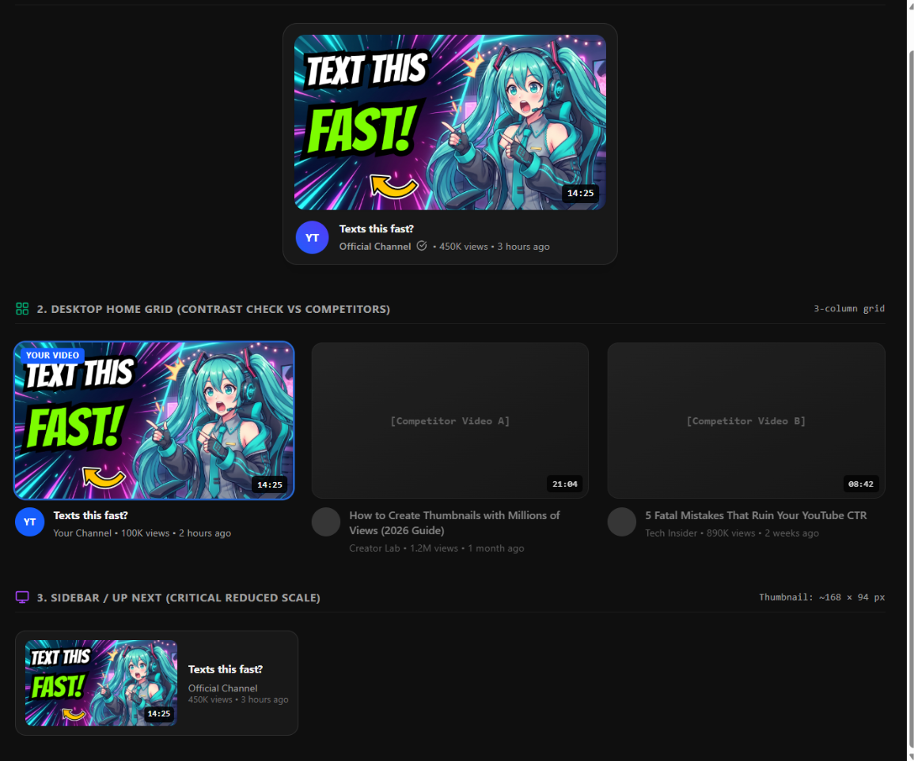

<div align="center">


# YText Studio

**AI-powered art direction for YouTube thumbnails. Upload your image and generate high-impact typography titles ready to publish in seconds.**

[](https://react.dev/)
[](https://www.typescriptlang.org/)
[](https://tailwindcss.com/)
[](https://vitejs.dev/)
[](https://tauri.app/)
[](https://www.rust-lang.org/)
[](https://vitest.dev/)
[](LICENSE)

<br/>

🌐 **Language / Idioma:** **🇺🇸 English** • <a href="./README.es.md">🇪🇸 Español</a>

</div>

<p align="center">
  
</p>

---

**YText Studio** is a free, open-source tool built to accelerate YouTube thumbnail creation by combining **visual multimodal AI** with an **ergonomic canvas editor designed for creators without professional software experience**.

Instead of staring at a blank canvas wondering which font to pick, where to place text, or what colors maximize contrast, the AI analyzes your image, distills your concept into high-converting hook phrases, and designs multiple complete visual proposals ready to apply and customize in a single click.

> 🌍 **Bilingual & Language Mirroring:** The UI features a real-time language switcher (**English / Español**). Additionally, the AI automatically detects your input title language: enter your concept in English and it outputs English hooks; enter it in Spanish and it outputs Spanish hooks.

---

## The Problem & The Solution

- **The Problem:** Crafting attention-grabbing titles for thumbnails typically requires complex software like Photoshop and graphic design expertise (composition, contrast ratios, typographic hierarchy, and readability). When text blends into background clutter or is too lengthy, the thumbnail gets overlooked on mobile feeds in under 0.2 seconds, killing click-through rates (CTR).
- **The Solution:** A true *plug-and-play* workflow where AI handles spatial analysis and typography art direction for you, backed by tactile visual controls to tweak the final layout in seconds with zero learning curve.

---

## How It Accelerates Your Creative Workflow

1. **🤖 Automated AI Art Direction**  
   Upload your background image, enter your video topic, and choose an emotional intent (*Hype, Mystery, Tech, Horror, etc.*). The AI inspects the composition, detects unobstructed negative space away from faces/subjects, and generates **3 to 5 distinct, complete proposals** featuring concise hooks, complementary color palettes, and matching fonts.
2. **🎨 Instant Visual Customization**  
   Tailor any proposal on the fly: switch between 12 battle-tested YouTube fonts, fine-tune colors, apply vertical gradients, thick outer strokes, extruded 3D shadows, contrast background containers (*badges*) to rescue text from busy backgrounds, and add graphic stickers or arrows with die-cut white borders.
3. **📱 Real-Time YouTube Simulator & Mobile Readability**  
   Preview exactly how your design appears on a real smartphone feed (~320×180 px), desktop browse grid, or sidebar recommendations. Includes a real-time Thumbnail Readability Index (TRI) score and automated collision alerts when text overlaps YouTube’s bottom-right video duration badge (`14:25`).

<p align="center">
  
</p>

4. **⚡ Official YouTube Resolution Export**  
   Download your finalized thumbnail in exact YouTube dimensions (`1280×720` standard or `1920×1080` Full HD) in lossless PNG or clean JPG.

---

## Requirements, AI Drivers & Download

### Requirements
- **100% Free:** No subscriptions, no required accounts, and no watermarks on your exports.
- **AI Connectivity:** You only need an API Key from any supported provider below. Your credentials remain strictly on your local machine (`localStorage`).

### 🔌 Supported AI Drivers
Click on any supported provider below to get your API key or install the local engine:

[](https://aistudio.google.com/apikey)
[](https://openrouter.ai/keys)
[](https://platform.openai.com/api-keys)
[-000000?style=for-the-badge&logo=ollama&logoColor=white)](https://ollama.com/)

| Provider | Default Recommended Model | Access Type | Direct Link |
| :--- | :--- | :--- | :--- |
| **Google Gemini** | `gemini-2.0-flash` | Free tier available / Pay-as-you-go | [Get API Key at Google AI Studio](https://aistudio.google.com/apikey) |
| **OpenRouter** | `anthropic/claude-3.5-sonnet` | Unified multimodels (Prepaid / Free models) | [Get API Key at OpenRouter](https://openrouter.ai/keys) |
| **OpenAI** | `gpt-4o` / `gpt-4o-mini` | Pay-as-you-go (Official API) | [Get API Key at OpenAI Platform](https://platform.openai.com/api-keys) |
| **Ollama** | `llama3.2-vision` | 100% Local and offline | [Download Ollama](https://ollama.com/) |

### ⚡ Ultra-Low Token Consumption & Smart Image Compression
YText Studio is engineered from the ground up to minimize token costs on every request:

- **Lossless Dual Compression:** Even if you upload a heavy 4K or Full HD image, the app generates an in-memory lightweight **WebP copy (`640 px`, `< 40 KB`)** solely for fast AI vision inspection—saving over **80% in vision tokens**—while **keeping your full-resolution source image untouched** for export.
- **One-Shot Architecture (0 tokens during editing):** Tokens are only consumed when you click **"Analyze"**. All subsequent design tweaks (moving text, switching fonts, adjusting colors, shadows, stickers, and exporting) execute 100% locally on your machine and consume **0 tokens**.
- **Average Cost & Consumption per Request:** **~1,800 total tokens** per analysis (~258 vision tokens + ~900 prompt tokens + ~650 response tokens):
  - With **Google Gemini Flash Free Tier** or **Ollama Local**: **$0.00 USD**.
  - With paid API credits (`gemini-2.0-flash` / `gpt-4o-mini`): **`~$0.0004 USD` per run** (more than **2,500 complete analyses per $1 USD**).

### Desktop Download (Windows & macOS)
If you prefer running the app directly on your computer without running terminal commands:

1. Head to the **[Releases](../../releases)** section of this repository.
2. Download the installer package for your operating system:
   - 🪟 **Windows:** Executable installer (`.exe` or `.msi`).
   - 🍏 **macOS:** Disk image (`.dmg`).

---

<br>

<div align="center">
  <h3>🛠️ Developer Documentation</h3>
</div>

### Technical Architecture

YText Studio follows a **Local-First / Zero-Backend** architecture: vision processing, graphics rendering, and export pipelines run entirely in client memory without intermediate servers or databases.

- **Vision & AI Art Direction Pipeline (`src/core/lmm/`):** Multimodal adapter supporting Google Gemini, OpenRouter, OpenAI, and Ollama. Compresses images on-device via `OffscreenCanvas` (WebP 640px) for one-shot spatial analysis, negative space detection, and structured JSON output with strict schema sanitization.
- **2D Canvas Engine (`src/core/canvas/`):** Hardware-accelerated vector rendering loop operating at 60–120 FPS, fully decoupled from React's reconciliation cycle. Uses concentric multi-pass strokes for clean outlines, 45° 3D extrusion, die-cut sticker compositing, and affine matrix transformations via `DOMMatrix`.
- **Deterministic Layout & Safe Zones (`src/core/layout/`, `src/core/safezones/`):** Spatial quadrant positioning with real-time AABB collision detection against YouTube’s reserved duration badge overlay.
- **Thumbnail Readability Index (`src/core/metrics/ReadabilityCalculator.ts`):** Reactive, multi-line algorithmic metric auditing word density, projected mobile font sizes (`320×180 px`), and contrast protection across all segments.
- **Lossless Exporter (`src/core/canvas/OffscreenExporter.ts`):** Virtual buffer rasterization independent of display DPI at `1280×720` and `1920×1080` using high-quality bicubic interpolation (`imageSmoothingQuality = 'high'`).
- **Reactive i18n Engine (`src/i18n/`):** Lightweight, strictly-typed TypeScript internationalization engine providing instantaneous switching between English (`en`) and Spanish (`es`) with zero external runtime dependencies.
- **Native Packaging (`src-tauri/`):** Cross-platform desktop shell powered by Tauri v2 and Rust, backed by automated GitHub Actions build pipelines (`.github/workflows/release-desktop.yml`).

### Prerequisites

- **Node.js:** v18+ (v22 LTS recommended).
- **Rust Toolchain:** Only required if building native desktop binaries locally ([rustup.rs](https://rustup.rs/)).

### Local Setup & Commands

```bash
# 1. Clone repository
git clone https://github.com/your-username/ytext-studio.git
cd ytext-studio

# 2. Install dependencies
npm install

# 3. Start web development server (Vite)
npm run dev

# 4. Launch desktop application in dev mode (Tauri)
npm run tauri:dev

# 5. Run full unit test suite (Vitest)
npm test

# 6. Build web production client
npm run build

# 7. Package native desktop installers (.exe / .msi / .dmg)
npm run tauri:build
```

---

## ⚖️ License & Disclaimer of Liability

This project is open-source software distributed freely under the **[MIT License](LICENSE)**.

By downloading, installing, compiling, or using **YText Studio**, you expressly accept the following terms:

1. **"AS IS" Delivery & Limitation of Liability:**  
   The software is provided **"AS IS"**, without warranty of any kind, express or implied. Under no circumstances shall the author or contributors be liable for any claim, damages, or other liability—whether in an action of contract, tort, or otherwise—arising from, out of, or in connection with the software or the use or other dealings in the software.
2. **Third-Party API Usage & Costs:**  
   The application enables connecting external AI services (Google Gemini, OpenRouter, OpenAI, etc.) using keys provided by the user. The user assumes **sole responsibility** for safeguarding their API credentials, adhering to each provider's terms of service, and managing any billing or charges incurred.
3. **User Content & Intellectual Property:**  
   The user maintains **exclusive legal responsibility** for all imagery, graphics, copy, and typography processed, generated, or exported with this tool. The author assumes no liability for copyright infringement, trademark disputes, channel penalties, monetization decisions, or commercial performance on YouTube or any other platform.
