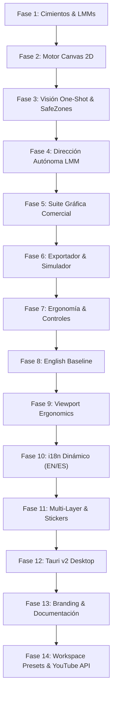

# Roadmap Maestro: YText Studio (YT Cover Typography Studio)

## Visión General del Producto
**YText Studio** es una plataforma web y de escritorio especializada de grado comercial diseñada para optimizar y componer el activo visual más determinante del CTR en video digital: el **Layer Tipográfico y Gráfico de Portadas de YouTube**.

A diferencia de los editores gráficos tradicionales (Photoshop, Canva), el sistema trata la imagen base como un fondo inmutable (16:9) y centra toda su capacidad en el análisis de composición visual, detección de espacio negativo por IA, dirección de arte 100% autónoma, renderizado vectorial de alto impacto con manipulación táctil directa a 60–120 FPS, arquitectura multi-capa para stickers y validación multi-contexto de feeds.

---

## Filosofía Operativa del Roadmap
Este documento es la **Fuente Única de la Verdad (Single Source of Truth - SSOT)** del producto y rige la secuencia maestra de construcción:
1. **SSOT Viva y Fiel al Código:** Toda fase completada describe con exactitud matemática lo que existe en el repositorio, purgando cualquier patrón o preset deprecated.
2. **Ciclo por Fase:** Cada fase se activa mediante su propio `implementation_plan.md` granular, su **Task 0 de Git** correspondiente (`git checkout -b <nombre-rama>`) y su estrategia de verificación técnica antes de pasar a la siguiente.
3. **Cero Deuda Técnica:** APIs nativas del navegador (`Canvas 2D`, `DOMMatrix`, `OffscreenCanvas`, `fetch`), consumo mínimo de RAM (<40MB) y desacoplamiento de costos de IA.

---

## Tabla de Estado Maestro (Phase Status Tracker)

| Fase | Nombre del Hito | Rama en Git | Estado Actual | Verificación |
| :---: | :--- | :--- | :---: | :---: |
| **Fase 1** | Cimientos, LMMs Universales & Workspace Base | `feature/phase-1-setup-and-foundation` | **🟢 COMPLETADA** | Build OK (87kB) • Vitest OK |
| **Fase 2** | Micro-Motor Gráfico Canvas 2D & Bounding Box | `feature/phase-2-canvas-engine` | **🟢 COMPLETADA** | Build OK (89kB) • 7 Tests OK |
| **Fase 3** | Visión One-Shot & Safe Zones de YouTube | `feature/phase-3-vision-safezones` | **🟢 COMPLETADA** | Build OK (90kB) • 20 Tests OK |
| **Fase 4** | Dirección de Arte Autónoma 100% & Telemetría LMM | `feature/ai-autonomous-director` | **🟢 COMPLETADA** | Build OK (94kB) • 21 Tests OK |
| **Fase 5** | Suite Gráfica Comercial de Alta Variabilidad ("Nivel Photoshop") | `feature/ai-autonomous-director` | **🟢 COMPLETADA** | Build OK (96kB) • 21 Tests OK |
| **Fase 6** | Simulador de Feeds Multi-Contexto & Exportación Lossless | `feature/phase-6-simulator-export` | **🟢 COMPLETADA** | Build OK (99kB) • 23 Tests OK |
| **Fase 7** | Ergonomía del Editor, Precision Controls & UX Fixes | `feature/phase-7-ergonomics-precision` | **🟢 COMPLETADA** | Build OK (100kB) • 23 Tests OK |
| **Fase 8** | Estandarización de Vocabulario en Inglés (en-US Baseline) | `feature/phase-8-global-english-i18n` | **🟢 COMPLETADA** | Build OK (342kB) • 23 Tests OK |
| **Fase 9** | Viewport Ergonomics (Paneles Colapsables) & UI Jargon Purge | `feature/phase-9-viewport-ergonomics-jargon-purge` | **🟢 COMPLETADA** | Build OK (345kB) • 23 Tests OK |
| **Fase 10** | Arquitectura de Internacionalización Dinámica (i18n Engine & Multilenguaje) | `feat/i18n-modular-architecture` | **🟢 COMPLETADA** | Build OK • 43 Tests OK |
| **Fase 11** | Multi-Layer Canvas & Graphic Assets / Sticker Engine | `feature/phase-11-multilayer-canvas-graphic-assets` | **🟢 COMPLETADA** | Build OK • 43 Tests OK |
| **Fase 12** | Aplicación de Escritorio Nativa (Tauri v2 Desktop) & Menús de Sistema | `feat/tauri-v2-desktop` | **🟢 COMPLETADA** | Tauri v2 Config OK • Cargo Test OK |
| **Fase 13** | Identidad de Marca Oficial & Documentación Bilingüe Global | `docs/public-readme` | **🟢 COMPLETADA** | 0 Errores TS • Suite 43 Tests OK |
| **Fase 14** | Workspace Presets & Publicación Directa a YouTube API v3 | `feat/youtube-api-publishing` | **⚪ PENDIENTE** | Planificación Comercial |

---

## Fases Maestras de Desarrollo

---

### Fase 1 a Fase 9 (Fundaciones y Maduración Gráfica)
*(Véase historial de commits y especificaciones matemáticas en `STANDARDS.md` para detalles de renderizado Canvas 2D, Safe Zones de YouTube, cálculo del TRI y dirección de arte autónoma).*

---

### Fase 10: Arquitectura de Internacionalización Dinámica (i18n Engine & Multilenguaje) (Completada)
* **Objetivo:** Desacoplar al 100% todos los textos de la interfaz mediante un motor de internacionalización ligero con tipado estricto, diccionarios externos y selector en vivo.
* **Contexto y Alcance Arquitectónico:**
  - **Motor Ligero Tipado (`I18nProvider` & `useTranslation`):** Contexto nativo de React (<1.5 KB, cero dependencias pesadas de terceros) con validación estricta de llaves en TypeScript (`keyof typeof en`).
  - **Catálogos Desacoplados (`src/locales/`):**
    - `en.json`: Diccionario canónico en inglés (vocabulario depurado en Fase 8 y 9).
    - `es.json`: Diccionario en español neutro profesional.
  - **Selector de Idioma en Vivo:** Switch interactivo `[EN / ES]` en el `Header` con re-renderizado instantáneo de la interfaz.
  - **Persistencia & Detección:** Detección automática del idioma del sistema (`navigator.language`) y persistencia en `localStorage ('ytext_locale')`.
  - **Aislamiento Total del Canvas:** El micro-motor gráfico Canvas 2D permanece inmune a los re-renders de idioma.

---

### Fase 11: Multi-Layer Canvas & Graphic Assets / Sticker Engine (Completada)
* **Objetivo:** Permitir importar, manipular e integrar elementos gráficos complementarios (logos, iconos, flechas, stickers PNG con canal alfa) junto a las capas tipográficas en el lienzo de 1280x720.
* **Contexto y Alcance Arquitectónico:**
  - **Arquitectura de Capas Multielemento (`CanvasLayer` & `GraphicAssetElement`):** Soporte de capas tipográficas y de imágenes ordenables por `zIndex` con transformación afín independiente.
  - **Efectos de Sticker para YouTube (`StickerRenderer`):**
    - Generación de siluetas de recorte con borde blanco/color (`destination-over`) cacheada en `scratchCanvas`.
    - Sombra 3D dura a 45° idéntica a la iluminación del texto.
  - **Manipulación Directa:** Drag & drop, escalado y rotación interactiva con Bounding Box.

---

### Fase 12: Aplicación de Escritorio Nativa (Tauri v2 Desktop) (Completada)
* **Objetivo:** Empaquetar YText Studio como una aplicación de escritorio nativa multiplataforma (Windows, macOS, Linux) con huella mínima de memoria (<40MB) y rendimiento gráfico ultra-rápido.
* **Contexto y Alcance Arquitectónico:**
  - **Configuración Tauri v2 (`src-tauri/`):** Integración con Rust y Tauri v2, iconografía de alta resolución (`app-icon.png`, `.ico`, `.icns`).
  - **Menús Nativos & Aceleración por Hardware:** Menú contextual nativo de escritorio, soporte para pantalla completa y shortcuts de sistema.
  - **CI/CD de Release Automatizado (`.github/workflows/release-desktop.yml`):** Generación automática de ejecutables de producción (MSI, DMG, AppImage) en cada tag de versión.

---

### Fase 13: Identidad de Marca Oficial & Documentación Bilingüe Global (Completada)
* **Objetivo:** Consolidar la identidad visual del producto y su presentación pública en GitHub con documentación técnica accesible para creadores y desarrolladores.
* **Contexto y Alcance Arquitectónico:**
  - **Branding Oficial:** Diseño de playmark de squircle multicapa (`public/favicon.svg`, `BrandLogo.tsx`).
  - **Documentación Dual Bilingüe:** `README.md` canónico en inglés y `README.es.md` en español, enlazados mediante switches de idioma nativos.
  - **Métricas de Consumo de IA:** Guías claras de costo y consumo de tokens (~1,800 tokens / ~$0.0004 USD por solicitud de visión WebP) y compatibilidad con Gemini, OpenRouter, OpenAI y Ollama.

---

### Fase 14: Workspace Presets & Publicación Directa a YouTube API v3 (Próxima Fase)
* **Objetivo:** Permitir guardar plantillas de estudio por canal y sincronizar directamente la miniatura final con videos existentes de YouTube Studio.
* **Contexto y Alcance Arquitectónico:**
  - **Preset Vault:** Guardar configuraciones completas de marca (fuentes, paletas, stickers recurrentes) en local y exportables en JSON.
  - **YouTube Data API v3 Adapter:** Conexión OAuth opcional para reemplazar o subir la miniatura generada directamente a un video de YouTube sin salir de la aplicación.
