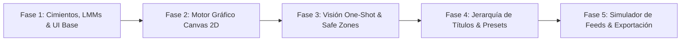

# Roadmap Maestro: YText Studio (YT Cover Typography Studio)

## Visión General del Producto
**YText Studio** es una plataforma web especializada de grado comercial diseñada para optimizar y componer el activo visual más determinante del CTR en video digital: el **Layer Tipográfico de Portadas de YouTube**.

A diferencia de los editores gráficos tradicionales (Photoshop, Canva), el sistema trata la imagen base como un fondo inmutable (16:9) y centra toda su capacidad en el análisis de composición visual, detección de espacio negativo, segmentación de títulos combinados (*Secondary Anchor* + *Primary Power Word*) y renderizado vectorial de alto impacto con estilos tipográficos estudiados, manipulación táctil directa a 60 FPS y validación multi-contexto de feeds.

---

## Filosofía Operativa del Roadmap
Este documento rige la secuencia maestra de construcción del sistema.
1. **Sin tareas atómicas aquí:** Este roadmap define el **contexto puntual, objetivos y límites arquitectónicos** de cada fase.
2. **Ciclo por fase:** Cada fase se activará de forma individual mediante su propio `implementation_plan.md` granular, su **Task 0 de Git** correspondiente (`git checkout -b <feature/fase-X>`) y su estrategia de verificación técnica antes de pasar a la siguiente.
3. **Cero deuda técnica:** Se priorizan APIs nativas del navegador (`Canvas 2D`, `DOMMatrix`, `OffscreenCanvas`, `fetch`), consumo mínimo de memoria RAM (<35MB) y desacoplamiento estricto de costos de IA.

---

## Tabla de Estado Maestro (Phase Status Tracker)

| Fase | Nombre del Hito | Rama en Git | Estado Actual | Verificación |
| :---: | :--- | :--- | :---: | :---: |
| **Fase 1** | Cimientos, LMMs Universales & Workspace Base | `feature/phase-1-setup-and-foundation` | **🟢 COMPLETADA** | Build OK (87kB) • Vitest OK |
| **Fase 2** | Micro-Motor Gráfico Canvas 2D & Bounding Box | `feature/phase-2-canvas-engine` | **🟢 COMPLETADA** | Build OK (89kB) • 7 Tests OK |
| **Fase 3** | Visión One-Shot & Safe Zones de YouTube | `feature/phase-3-vision-safezones` | **🟡 EN PLANIFICACIÓN** | Requiere Aprobación + Task 0 |
| **Fase 4** | Títulos Combinados & Presets de Alto CTR | `feature/phase-4-typo-hierarchy` | **⚪ PENDIENTE** | Requiere Plan + Task 0 |
| **Fase 5** | Simulador de Feeds & Exportación Lossless | `feature/phase-5-simulator-export` | **⚪ PENDIENTE** | Requiere Plan + Task 0 |

---

## Fases Maestras de Desarrollo

---

### Fase 1: Cimientos del Sistema, Conectividad LMM Universal y Workspace Base
* **Objetivo:** Establecer la arquitectura base del proyecto, el sistema de diseño en modo claro (*Clean Studio Light*), la gestión de almacenamiento local y la capa de abstracción para los proveedores de IA más utilizados por la comunidad.
* **Contexto y Alcance Arquitectónico:**
  - **Stack Base:** Inicialización con Vite + React 19 + TypeScript + Tailwind CSS v4.
  - **Módulo de Configuración Rápida (`SettingsModal`):**
    - Almacenamiento seguro en cliente (`localStorage`) de claves de API.
    - Soporte multi-proveedor: **Google Gemini** (Gemini 2.0 Flash / 1.5 Flash), **OpenRouter** (Claude 3.5 Sonnet, GPT-4o, Qwen 2.5-VL), **OpenAI Directo** y **Servidores Locales / Ollama** (Llama 3.2 Vision).
  - **Capa de Red Unificada (`LMMService`):**
    - Patrón Adaptador (*Adapter Pattern*) en TypeScript puro con `fetch` nativo (cero SDKs inflados).
    - Normalización de salidas mediante contratos estrictos en formato JSON Schema.
  - **Shell de la Aplicación:**
    - Maquetación de 3 columnas (Panel de Ingesta, Canvas Central de Observación, Inspector Lateral).
    - Estética visual: Modo claro minimalista, paleta Slate/Zinc suave, sin elementos chillones ni distracciones.

---

### Fase 2: Micro-Motor Gráfico Nativo (Canvas 2D Engine) y Bounding Box Interactivo
* **Objetivo:** Implementar un motor de renderizado gráfico vectorial directo sobre la API Canvas 2D nativa del navegador, logrando manipulación tipo Paint/Figma a 60–120 FPS sin librerías pesadas (eliminando Fabric.js).
* **Contexto y Alcance Arquitectónico:**
  - **`CanvasEngine` Desacoplado:**
    - Montaje y renderizado de la imagen base inmutable con aspect-ratio fijo 16:9.
    - Aislamiento del bucle de dibujo (`requestAnimationFrame`) fuera del ciclo de reconciliación del Virtual DOM de React (0 lag).
  - **Sistema de Transformación Bounding Box:**
    - Cálculo matemático 2D con `DOMMatrix` para arrastre libre (*drag*), escalado proporcional desde 8 tiradores (*scale*) y rotación suave (*rotate*).
  - **Pipeline de Renderizado Tipográfico Avanzado:**
    - Resolución del *Stroke Bug* de HTML5 Canvas mediante la directiva `paintFirst: 'stroke'`.
    - Soporte para doble contorno perimetral concéntrico exterior (borde interior de contraste + borde exterior oscuro masivo).
    - Extrusión de sombra 3D direccional dura (cero desenfoque, offset escalonado).
    - Preloader estricto de glifos vectoriales con `document.fonts.load()` para evitar fallos de renderizado asíncrono.

---

### Fase 3: Análisis de Visión One-Shot, Detección de Espacio Negativo y Guardián de YouTube
* **Objetivo:** Conectar el análisis visual sin incurrir en costes repetitivos de tokens y blindar la composición contra los recortes y marcas de agua de YouTube.
* **Contexto y Alcance Arquitectónico:**
  - **Pipeline de Visión One-Shot (Ahorro de Tokens):**
    - Compresión instantánea en cliente a WebP 640px (<50KB) vía `OffscreenCanvas` antes de transmitir.
    - Ejecución única por imagen: la IA analiza el cuadrante del sujeto (`subject_zone`), las zonas de espacio negativo libre (`free_zones`) y la paleta cromática complementaria.
    - Caché local en memoria: cambios de texto o tipografía posteriores no reenvían la imagen.
  - **Motor de Layout Determinista (`DeterministicLayoutEngine`):**
    - Mapeo matemático entre el cuadrante semántico de la IA y las coordenadas `{x, y}` de la pantalla, con márgenes de seguridad proporcionales y anclajes perfectos.
  - **Guardián de Zonas de Exclusión de YouTube (`SafeZoneGuard`):**
    - Detección de colisión AABB contra el badge de duración de YouTube (esquina inferior derecha `14:25`).
    - Alerta visual inmediata y comportamiento elástico (*snap-back*) si el usuario o la IA posicionan texto en zonas críticas.
    - Overlay interactivo conmutador para ver la interfaz real de YouTube superpuesta.

---

### Fase 4: Jerarquía de Títulos Combinados, Presets Estudiados y Generador de Copys
* **Objetivo:** Dotar a la aplicación de la capacidad de segmentar palabras clave con estilos diferenciados y proporcionar un catálogo de arquetipos tipográficos de alto CTR.
* **Contexto y Alcance Arquitectónico:**
  - **Arquitectura de Segmentación Multilínea (`CompositeTextGroup`):**
    - Soporte nativo para títulos combinados (ej. *"MEJOR DISCO"* en estilo secundario + *"DE ROCK"* en estilo primario de alto impacto).
    - Manipulación unificada en el lienzo (un solo bounding box) y personalización granular en el inspector lateral (fuente, color, tamaño relativo por segmento).
    - Acción rápida de 1 clic: "Invertir Jerarquía" visual.
  - **Catálogo de Presets Estudiados (Composite Typo Styles):**
    - *MrBeast / Viral Pop:* Komika/Luckiest Guy + degradado amarillo + doble borde negro + extrusión 3D.
    - *Docu-Drama / Mystery:* Anton/Bebas condensada + blanco/rojo puro + sombra de oclusión profunda.
    - *Gaming / Tech Neon:* Bangers/Montserrat en ángulo -5° + degradado cian/magenta + resplandor perimetral.
    - *Authority / Business:* Inter/Montserrat Black compacta sobre badge/pill con esquinas redondeadas.
  - **Optimizador de Densidad de Texto:**
    - Cálculo en tiempo real del *Thumbnail Readability Index* (TRI) evaluando longitud y legibilidad en pantallas reducidas.
    - Botón de 1 clic: "Sintetizar a Power Words" (reduce frases largas a 2-4 palabras clave).
    - Generación y conmutación rápida entre 3 tarjetas de propuesta (A, B, C).

---

### Fase 5: Simulador Multi-Contexto de YouTube y Pipeline de Exportación Lossless
* **Objetivo:** Permitir la validación del impacto visual en los entornos reales de consumo de YouTube y exportar la portada con nitidez milimétrica sin pérdida de calidad.
* **Contexto y Alcance Arquitectónico:**
  - **Simulador de Feeds de YouTube (The Reality Check):**
    - *Vista Móvil (App):* Miniatura simulada a ~320x180 px con timestamp real y contexto de feed móvil (donde ocurre el 70% del tráfico).
    - *Vista Desktop (Home):* Renderizado en grid con alternancia entre Modo Oscuro y Modo Claro de YouTube.
    - *Vista Sidebar (Up Next / Relacionados):* Miniatura a ~168x94 px para comprobación extrema de contraste.
  - **Pipeline de Exportación Lossless (`OffscreenExporter`):**
    - Desacoplamiento total de la resolución de pantalla del monitor.
    - Creación de un buffer virtual en `OffscreenCanvas` a resolución oficial 1280x720 (estándar YouTube) y opción 1920x1080 (Full HD).
    - Renderizado bicúbico de la imagen fuente original en máxima calidad (`imageSmoothingQuality = 'high'`).
    - Rasterizado vectorial directo de las capas de texto.
    - Exportación a PNG sin pérdida (*lossless*) y JPEG de calidad 1.0.
