# Roadmap Maestro: YText Studio (YT Cover Typography Studio)

## Visión General del Producto
**YText Studio** es una plataforma web especializada de grado comercial diseñada para optimizar y componer el activo visual más determinante del CTR en video digital: el **Layer Tipográfico de Portadas de YouTube**.

A diferencia de los editores gráficos tradicionales (Photoshop, Canva), el sistema trata la imagen base como un fondo inmutable (16:9) y centra toda su capacidad en el análisis de composición visual, detección de espacio negativo por IA, dirección de arte 100% autónoma, renderizado vectorial de alto impacto con manipulación táctil directa a 60–120 FPS y validación multi-contexto de feeds.

---

## Filosofía Operativa del Roadmap
Este documento es la **Fuente Única de la Verdad (Single Source of Truth - SST)** del producto y rige la secuencia maestra de construcción:
1. **SST Viva y Fiel al Código:** Toda fase completada describe con exactitud matemática lo que existe en el repositorio, purgando cualquier patrón o preset deprecated.
2. **Ciclo por Fase:** Cada fase se activa mediante su propio `implementation_plan.md` granular, su **Task 0 de Git** correspondiente (`git checkout -b <feature/fase-X>`) y su estrategia de verificación técnica antes de pasar a la siguiente.
3. **Cero Deuda Técnica:** APIs nativas del navegador (`Canvas 2D`, `DOMMatrix`, `OffscreenCanvas`, `fetch`), consumo mínimo de RAM (<35MB) y desacoplamiento de costos de IA.

---

## Tabla de Estado Maestro (Phase Status Tracker)

| Fase | Nombre del Hito | Rama en Git | Estado Actual | Verificación |
| :---: | :--- | :--- | :---: | :---: |
| **Fase 1** | Cimientos, LMMs Universales & Workspace Base | `feature/phase-1-setup-and-foundation` | **🟢 COMPLETADA** | Build OK (87kB) • Vitest OK |
| **Fase 2** | Micro-Motor Gráfico Canvas 2D & Bounding Box | `feature/phase-2-canvas-engine` | **🟢 COMPLETADA** | Build OK (89kB) • 7 Tests OK |
| **Fase 3** | Visión One-Shot & Safe Zones de YouTube | `feature/phase-3-vision-safezones` | **🟢 COMPLETADA** | Build OK (90kB) • 20 Tests OK |
| **Fase 4** | Dirección de Arte Autónoma 100% & Telemetría LMM | `feature/ai-autonomous-director` | **🟢 COMPLETADA** | Build OK (94kB) • 21 Tests OK |
| **Fase 5** | Suite Gráfica Comercial de Alta Variabilidad ("Nivel Photoshop") | `feature/ai-autonomous-director` | **🟢 COMPLETADA** | Build OK (96kB) • 21 Tests OK |
| **Fase 6** | Simulador de Feeds Multi-Contexto & Exportación Lossless | `feature/phase-6-simulator-export` | **🟢 COMPLETADA** | Build OK (99kB) • 23 Tests OK |
| **Fase 7** | Ergonomía del Editor, Precision Controls & UX Fixes | `feature/phase-7-ergonomics-precision` | **🟢 COMPLETADA** | Build OK (100kB) • 23 Tests OK |
| **Fase 8** | Estandarización de Vocabulario en Inglés (en-US Baseline) | `feature/phase-8-global-english-i18n` | **🟢 COMPLETADA** | Build OK (342kB) • 23 Tests OK |
| **Fase 9** | Arquitectura de Internacionalización Dinámica (i18n Engine & Multilenguaje) | `feature/phase-9-dynamic-i18n` | **⚪ PENDIENTE** | Requiere Plan + Task 0 |

---

## Fases Maestras de Desarrollo

```mermaid
flowchart LR
    Fase1["Fase 1: Cimientos & LMMs"] --> Fase2["Fase 2: Motor Canvas 2D"]
    Fase2 --> Fase3["Fase 3: Visión One-Shot & SafeZones"]
    Fase3 --> Fase4["Fase 4: Dirección Autónoma LMM"]
    Fase4 --> Fase5["Fase 5: Suite Gráfica Comercial"]
    Fase5 --> Fase6["Fase 6: Exportador & Simulador"]
    Fase6 --> Fase7["Fase 7: Ergonomía & Controles de Precisión"]
    Fase7 --> Fase8["Fase 8: English Baseline"]
    Fase8 --> Fase9["Fase 9: Motor Dinámico i18n"]
```

---

### Fase 1: Cimientos del Sistema, Conectividad LMM Universal y Workspace Base
* **Objetivo:** Establecer la arquitectura base del proyecto, el sistema de diseño en modo claro (*Clean Studio Light*), la gestión de almacenamiento local y la capa de abstracción para proveedores de IA.
* **Contexto y Alcance Arquitectónico:**
  - **Stack Base:** Vite + React 19 + TypeScript + Tailwind CSS v4.
  - **Configuración Rápida (`SettingsModal`):** Almacenamiento seguro en cliente (`localStorage`) de API Keys para Google Gemini, OpenRouter, OpenAI y Ollama.
  - **Capa de Red Unificada (`LMMService`):** Patrón Adaptador en TypeScript con `fetch` nativo y contratos en JSON Schema.
  - **Shell de la Aplicación:** Maquetación de 3 columnas (Ingesta, Canvas Central, Inspector).

---

### Fase 2: Micro-Motor Gráfico Nativo (Canvas 2D Engine) y Bounding Box Interactivo
* **Objetivo:** Renderizado vectorial directo sobre la API Canvas 2D a 60–120 FPS sin librerías de terceros (cero Fabric.js).
* **Contexto y Alcance Arquitectónico:**
  - **`CanvasEngine` Desacoplado:** Montaje de imagen 16:9 y loop `requestAnimationFrame` fuera del ciclo de React.
  - **Transformación Bounding Box:** Matriz 2D (`DOMMatrix`) para arrastre, rotación sobre pivote real y escalado simétrico centrado.
  - **Pipeline Tipográfico Base:** Corrección de *Stroke Bug* con `paintFirst: 'stroke'`, doble contorno concéntrico exterior y precarga de glifos con `document.fonts.load()`.

---

### Fase 3: Análisis de Visión One-Shot, Detección de Espacio Negativo y Guardián de YouTube
* **Objetivo:** Conectar el análisis visual sin incurrir en costes repetitivos de tokens y blindar la composición contra los recortes de YouTube.
* **Contexto y Alcance Arquitectónico:**
  - **Pipeline Visión One-Shot:** Compresión cliente a WebP 640px (<50KB) vía `OffscreenCanvas`. Análisis de `subject_zone`, `free_zones` y paleta complementaria con caché en memoria.
  - **Layout Determinista (`DeterministicLayoutEngine`):** Mapeo de coordenadas `{x, y}` de anclaje con márgenes de seguridad.
  - **Guardián de Safe Zones (`SafeZoneGuard`):** Detección AABB contra el badge de duración de YouTube (`14:25`) con alerta visual y snap-back protector.

---

### Fase 4: Dirección de Arte Autónoma 100% por IA, Erradicación de Presets & Telemetría
* **Objetivo:** Eliminar presets estáticos rígidos y transformar al LMM en un Director de Arte Autónomo con observabilidad total de red.
* **Contexto y Alcance Arquitectónico:**
  - **Erradicación de Presets Fijos:** Eliminación total de `TypoPresetId` y estilos hardcodeados (`mrbeast_pop`, `gaming_neon`, `docu_drama`).
  - **Dirección de Arte Autónoma:** El LMM analiza la imagen y genera 3 propuestas dinámicas y completas (copys contextuales, fuentes, paleta de contraste, sombras, trazo y rotación).
  - **Consola de Red LMM Transparente:** Panel de auditoría en vivo en `ProposalsList.tsx` con pestañas de `📤 Envío (Request)` y `📥 Respuesta (LMM JSON)` con portapapeles de 1 clic.
  - **Protección de Red y UX Pulcra:** Timeout estricto de 20s con `AbortSignal` y Canvas 100% limpio al inicio (cero texto dummy).

---

### Fase 5: Suite Gráfica Comercial de Alta Variabilidad ("Nivel Photoshop sin Photoshop")
* **Objetivo:** Dotar al creador y a la IA de herramientas visuales cinematográficas de empaquetado comercial con control granular e independiente.
* **Contexto y Alcance Arquitectónico:**
  - **Ruptura del Canon Rígido de 2 Líneas:** Estructura flexible de 1 a 3 líneas con controles dinámicos de adición (`[+ Línea]`) y eliminación (`[×]`).
  - **Controles Granulares por Línea:** Ajuste individual de tamaño (`fontSize`), color primario, toggle de gradiente cenital (`gradientColorHex`) y badge protector (`hasBadge`) por segmento.
  - **Catálogo de 12 Tipografías Icónicas de YouTube:** `Teko`, `Permanent Marker`, `Poppins`, `Playfair Display`, `Anton`, `Bebas Neue`, `Cinzel`, `Inter`, `Rubik`, `Luckiest Guy`, `Bangers` y `Montserrat`.
  - **Volumen Gráfico Cinematográfico:** Renderizado de gradientes cenitales verticales y sombras 3D extrudidas en ángulo oblicuo a 45° (`x + Math.round(i * 0.75), y + i`).
  - **Composición Áurea:** Cuadrícula 3x3 de Regla de Tercios superpuesta al Canvas con toggle interactivo en el Header.
  - **Thumbnail Readability Index (TRI):** Cálculo algorítmico en tiempo real de legibilidad en pantallas pequeñas.

---

### Fase 6: Simulador Multi-Contexto de YouTube y Pipeline de Exportación Lossless
* **Objetivo:** Validar el impacto de la portada en los entornos reales de consumo de YouTube y exportar con nitidez milimétrica en alta resolución.
* **Contexto y Alcance Arquitectónico:**
  - **Simulador de Feeds de YouTube (The Reality Check):**
    - *Vista Móvil (App):* Miniatura simulada a ~320x180 px con timestamp real y contexto de feed móvil (donde ocurre el 70% del tráfico).
    - *Vista Desktop (Home):* Renderizado en grid con alternancia entre Modo Oscuro y Modo Claro de YouTube.
    - *Vista Sidebar (Up Next / Relacionados):* Miniatura a ~168x94 px para comprobación extrema de contraste en tamaños reducidos.
  - **Pipeline de Exportación Lossless (`OffscreenExporter`):**
    - Desacoplamiento total de la resolución de pantalla del monitor.
    - Buffer virtual en `OffscreenCanvas` a resolución oficial 1280x720 (estándar YouTube) y 1920x1080 (Full HD).
    - Renderizado bicúbico de la imagen fuente original en máxima calidad (`imageSmoothingQuality = 'high'`).
    - Rasterizado vectorial directo de las capas de texto.
    - Exportación a PNG sin pérdida (*lossless*) y JPEG de calidad 1.0.

---

### Fase 7: Ergonomía del Editor, Precision Controls & UX Fixes
* **Objetivo:** Pulir la experiencia de uso del creador, eliminando desbordamientos de interfaz y aportando control fino al lienzo y a las capas tipográficas.
* **Contexto y Alcance Arquitectónico:**
  - **Selector de Intenciones Dinámico:** Rediseño de tarjeta compacta de 2 líneas (título en negrita + descripción de apoyo) en `IntentSelector.tsx`, erradicando textos truncados con `...`.
  - **AI Proposals en Acordeón Discreto:** Plegado por defecto de la consola de red cruda y diagnósticos técnicos en `ProposalsList.tsx`, dejando las tarjetas de propuesta limpias y accesibles.
  - **Precisión Numérica en Inspector:** Sustitución de etiquetas pasivas por inputs numéricos editables en tiempo real (`<input type="number">`) sincronizados con el slider de tamaño.
  - **Reordenamiento Vertical de Líneas:** Controles `[↑]` y `[↓]` para intercambiar jerarquías entre líneas y purga del botón obsoleto "Invertir".
  - **Zoom de Espacio de Trabajo:** Barra flotante en `CanvasStage.tsx` (`[-]`, `100%`, `[+]`, `[Fit]`) con mapeo de coordenadas reactivo en `getBoundingClientRect()`.
  - **Sincronización Reactiva en Header:** Badge de conectividad fiel que refleja el proveedor activo o el modo offline, con acceso directo a configuración.
  - **Clarificación de Safe Zones:** Comunicación explícita del badge `14:25` de YouTube y renombramiento del simulador a `Feed Preview`.

---

### Fase 8: Estandarización de Vocabulario en Inglés (en-US Baseline)
* **Objetivo:** Depurar y unificar el vocabulario de la interfaz al inglés nativo de la industria audiovisual de YouTube, erradicando el Spanglish para sentar la base canónica de términos.
* **Contexto y Alcance Arquitectónico:**
  - Unificación de terminología en Header, paneles de ingesta e inspección, selector de intenciones, diagnósticos y modales de exportación y previsualización.
  - Base de redacción pulida lista para ser extraída al catálogo de traducciones.

---

### Fase 9: Arquitectura de Internacionalización Dinámica (i18n Engine & Multilenguaje)
* **Objetivo:** Desacoplar al 100% todos los textos de la interfaz mediante un motor de internacionalización ligero con tipado estricto, diccionarios externos y selector en vivo.
* **Contexto y Alcance Arquitectónico:**
  - **Motor Ligero Tipado (`I18nProvider` & `useTranslation`):** Contexto nativo de React (<1.5 KB, cero dependencias pesadas de terceros) con validación estricta de llaves en TypeScript (`keyof typeof en`).
  - **Catálogos Desacoplados (`src/locales/`):**
    - `en.json`: Diccionario canónico en inglés (vocabulario depurado en Fase 8).
    - `es.json`: Diccionario en español neutro profesional.
  - **Selector de Idioma en Vivo:** Switch interactivo `[EN / ES]` en el `Header` con re-renderizado instantáneo de la interfaz.
  - **Persistencia & Detección:** Detección automática del idioma del sistema (`navigator.language`) y persistencia en `localStorage ('ytext_locale')`.
  - **Aislamiento Total del Canvas:** El micro-motor gráfico Canvas 2D permanece inmune a los re-renders de idioma.

